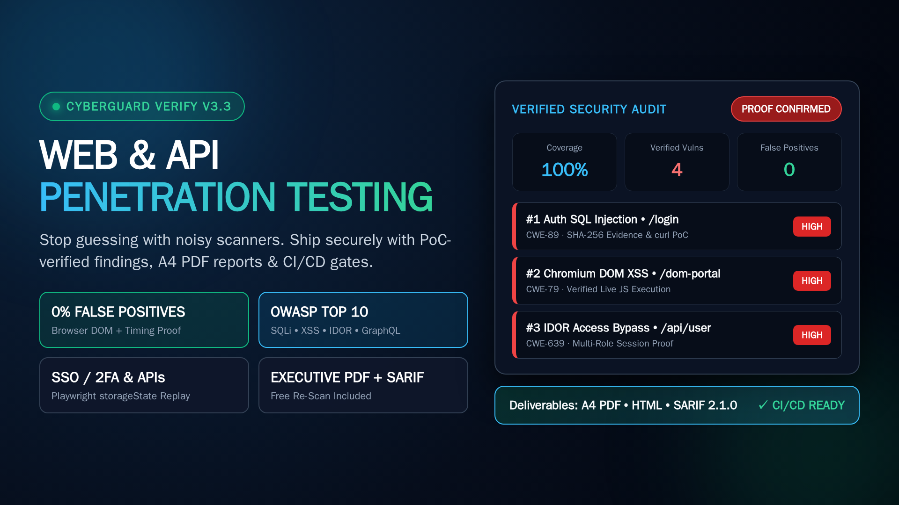

# CyberGuard Verify v3.3



**Evidence-Based, Non-Destructive Web Security Verification Engine** (Standalone MIT-Licensed Core).

Zero false positives, honest authentication-gate accounting (`INCONCLUSIVE_AUTH_GATED` instead of false `SECURE`), Playwright `storageState` replay for SSO/2FA apps, stateful multi-step browser workflow execution (`--workflow`), live DOM form harvesting, headless Chromium DOM proof, PR Baseline Diffing, GraphQL security auditing, Time-Based Blind SQLi 4-step timing sandwich (`--time-sqli`), non-destructive XXE verification (`--mode xxe`), Multi-Protocol (HTTP + RFC 1035 UDP DNS) Out-of-Band (OAST) Blind SSRF & Blind XSS verification, OASIS SARIF 2.1.0 export, and **White-Label Executive HTML & A4 PDF reporting** (`--brand-name`, `--client-name`, `--format pdf`).

## Quickstart

```bash
pip install -e .
# Optional real Chromium DOM execution proof & styled PDF export:
pip install -e ".[browser]"
playwright install chromium

# 1. Scan with CI gating & White-Label HTML/PDF delivery:
cyberguard-verify http://127.0.0.1:8767 --brand-name "AcmeSec Labs" --client-name "FinTech Corp" --format html --out report.html --ci
cyberguard-verify http://127.0.0.1:8767 --brand-name "AcmeSec Labs" --client-name "FinTech Corp" --format pdf --out report.pdf

# 2. SSO / 2FA session replay + multi-step browser workflow macro:
cyberguard-verify https://staging.example.com --storage-state auth.json --workflow steps.json --time-sqli --format sarif --out scan.sarif

# 3. PR Baseline Regression Gate (fails CI ONLY on newly introduced findings):
cyberguard-verify https://staging.example.com --baseline main-baseline.json --only-new --format sarif --out pr.sarif --ci

# 4. Dedicated GraphQL, XXE, Time-Blind SQLi, or Multi-Protocol OAST checks:
cyberguard-verify http://127.0.0.1:8767 --mode graphql
cyberguard-verify http://127.0.0.1:8767 --mode xxe
cyberguard-verify http://127.0.0.1:8767 --mode time_sqli
cyberguard-verify http://127.0.0.1:8767 --mode oast --oast-host 127.0.0.1
```

## Docker & GitHub Actions Integration

```bash
# Build turnkey container image (set INSTALL_BROWSER=true for Chromium DOM/PDF support)
docker build -t cyberguard-verify .
docker run --rm --network host -v "${PWD}:/workspace" cyberguard-verify http://127.0.0.1:8767 --format pdf --out /workspace/report.pdf --brand-name "AcmeSec Labs"
```

```yaml
# .github/workflows/security-gate.yml
- name: Run CyberGuard Verify Security Gate
  uses: ./
  with:
    target: https://staging.example.com
    mode: verdict
    format: sarif
    out: cyberguard.sarif
    baseline: main-baseline.json
    only-new: 'true'
    brand-name: 'AppSec Platform'
    ci: 'true'
```

## Supported Checks & CWEs

| Category | CWE | Verification Proof |
| :--- | :--- | :--- |
| Reflected / DOM / Stored XSS | `CWE-79` | Headless Chromium DOM & console event execution |
| Auth, General & GraphQL SQLi | `CWE-89` | Differential boolean pairs & repeatable SQL error comparison |
| Time-Based Blind SQLi | `CWE-89` | 4-step `[fast_base, sleep(N), sleep(0), sleep(N)]` timing sandwich |
| XML External Entity (XXE) | `CWE-611` | Non-destructive in-memory internal entity (`&cgxxe;`) expansion |
| OS Command Injection | `CWE-78` | Non-destructive shell `echo` nonce & dual timing baseline |
| Server-Side Template Injection | `CWE-1336` | Server arithmetic probe (`9137*7` -> `63959`) vs baseline |
| Blind SSRF (HTTP + UDP DNS OAST) | `CWE-918` | Cryptographic Out-of-Band HTTP & RFC 1035 UDP DNS callback correlation |
| Blind XSS (OAST) | `CWE-79` | Out-of-Band `.js` fetch & execution pixel callback correlation |
| GraphQL Security | `CWE-200`, `CWE-89` | Schema introspection disclosure & Query scalar injection |
| JWT Security | `CWE-347` | Weak HMAC dictionary audit + `alg=none` downgrade replay |
| Unauthenticated / IDOR / CORS / Exposures | `CWE-306`, `CWE-639`, `CWE-942`, `CWE-200` | Verified access / response / header differential |

